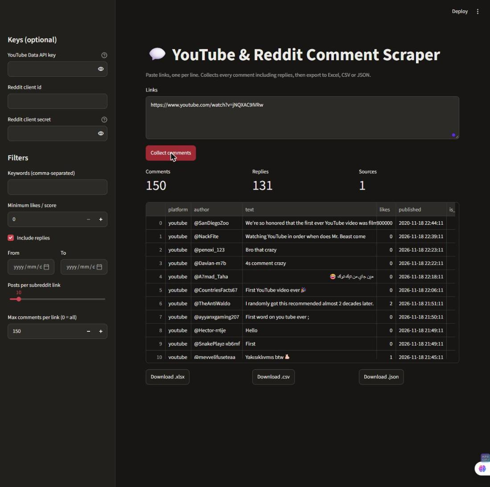

# YouTube & Reddit Comment Scraper

Collect **every comment, including replies,** from YouTube videos and Reddit posts or subreddits,
then export to **Excel, CSV or JSON**. Use the web UI or the command line.



## Features

- **YouTube:** any video, Shorts or youtu.be link
  - *No-key mode* (default): no setup at all. Dates are approximate (YouTube only shows "2 days ago").
  - *Official Data API mode*: add a free API key for exact timestamps and the most stable long-term use.
- **Reddit:** post links (the whole comment tree, including "load more comments") or subreddit links (latest/hot/top posts)
  through the official Reddit API.
- Fields: `platform, source_url, post_title, comment_id, parent_id, is_reply, author, text, likes, published, permalink`
- Filters: keywords, minimum likes, date range, top-level only, max comments per link
- Excel output with a frozen header, filters, wrapped text and a per-source **Summary** sheet.
  Text starting with `=` is stored as text, never run as a formula.
- One bad link never stops the run; errors are listed at the end.

## Install

```bash
python -m venv .venv
.venv\Scripts\activate        # macOS/Linux: source .venv/bin/activate
pip install -r requirements.txt
```

## Web UI

```bash
streamlit run app.py
```

Paste links, one per line, then click **Collect comments** and download .xlsx, .csv or .json.

## Command line

```bash
python cli.py https://www.youtube.com/watch?v=VIDEO_ID -o comments.xlsx
python cli.py -f links.txt -o all.csv --keywords price,refund --min-likes 5 --from 2026-01-01
python cli.py https://www.reddit.com/r/SUBREDDIT/ --subreddit-posts 25 -o sub.xlsx
```

## API keys (optional for YouTube, needed for Reddit)

| Platform | Where to get it | How to pass it |
|---|---|---|
| YouTube Data API v3 | Google Cloud Console → APIs → YouTube Data API v3 → Credentials → API key | `YOUTUBE_API_KEY` env var, `--youtube-key` or the UI sidebar |
| Reddit | https://www.reddit.com/prefs/apps → "create app" → type **script** | `REDDIT_CLIENT_ID` / `REDDIT_CLIENT_SECRET`, or the UI sidebar |

Reddit blocks most anonymous script traffic, so the tool uses Reddit's official OAuth API with your app keys.

## Tests

```bash
python tests/test_scraper.py
```

Offline tests cover the Reddit comment tree (nested replies plus "load more" expansion), filters, number parsing
and all three exports.

## License

MIT
